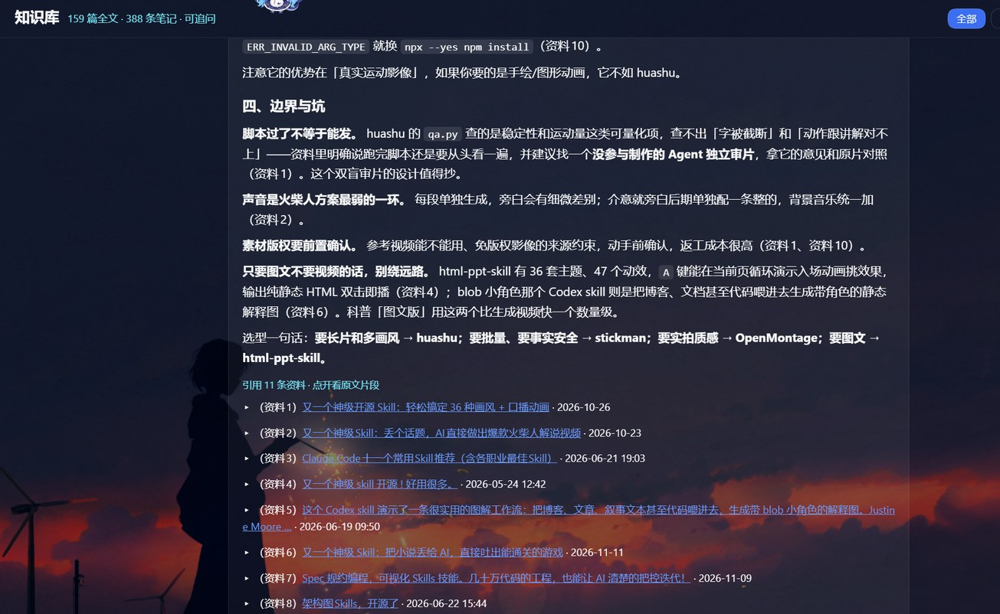

# dsh-kb

简体中文 | [English](README.en.md)

[DeepSeek Harness](https://github.com/deepseek-ai/deepseek-harness) 的本地知识库插件 —— 左栏一个对话框，直接**用你自己的文档**回答问题，并给出出处。

指向一个装满 Markdown、PDF、Word、文本的文件夹，它会在本地切块、向量化，检索出最相关的段落，再让模型**只依据这些段落**作答。

```
提问 ──> 段落检索（向量 + 关键词 + MMR） ──> 模型综合 ──> 带（资料N）引用的答案
```

用自然语言问就行，得到的是整理过的答案，不是一堆链接。



## 能做什么

- **是对话框，不是搜索框。** 自然语言提问，输出的是综合后的答案而不是链接列表。
- **引用点得开。** 每条回答下列出出处，点一下展开命中的原文片段和文件路径。
- **Agent 工具。** 注册了 `kb_search`、`kb_ask`、`kb_rebuild`，对话中途 Agent 可以直接查库，不用你切面板。
- **文档导入。** 文件丢进 `kb/inbox/`（或点面板上的**重建索引**），自动解析、切块、入库 —— PDF、DOCX、TXT、MD 以及常见源码文件。
- **增量索引。** 向量按段落哈希缓存，加一篇新文档只嵌入它自己的块（几秒，而不是几分钟）。
- **来源筛选。** `fav` / `chat` / `import` 三类来源分开，提问时可以限定其中一类。
- **网页文章导入。** `python fetch_urls.py <url> …` 把公众号 / 网页正文拉进库里。

## 依赖

- DeepSeek Harness 0.2.x
- Python 3.10+，需要 `sentence-transformers`、`numpy`、`requests`、`pyyaml`
  （`pip install sentence-transformers numpy requests pyyaml`）；`pypdf` 和 `python-docx` 可选，用于导入 PDF/DOCX
- DeepSeek API key，放在 `~/.dsh/.credentials.yaml` 的 `refs.DEEPSEEK_API_KEY`，或环境变量 `DEEPSEEK_API_KEY`

首次启动会下载 `BAAI/bge-small-zh-v1.5` 嵌入模型（约 95 MB，纯 CPU 运行）。

## 安装

```bash
# 在要装它的 profile 下执行
dsh plugin --profile <profile> add /absolute/path/to/dsh-kb
```

也可以在「插件市场 / 插件管理器」里用目录路径安装。

首次激活时，插件会创建 `~/.dsh/kb`，把 Python 服务拷贝进去，并在 `127.0.0.1:8765` 启动。左栏会出现 **知识库** 面板。

## 往里加内容

1. 文件丢进 `~/.dsh/kb/inbox/` —— PDF、DOCX、TXT、MD、源码都行。
2. 点面板右上角的**重建索引**（或让 Agent 调 `kb_rebuild`）。
3. 导入完文件会移到 `inbox/done/`，笔记落在 `~/.dsh/kb/notes/import/`。

抓取网页文章：

```bash
cd ~/.dsh/kb
python fetch_urls.py https://mp.weixin.qq.com/s/xxxx https://example.com/post
```

然后重建索引。每条导入的笔记都是普通 Markdown 加 frontmatter（`title`、`date`、`kind`、`url`），也可以手写。

## 配置

插件行支持这些字段：

| 字段 | 默认值 | 含义 |
| --- | --- | --- |
| `kbDir` | `~/.dsh/kb` | 知识库目录（笔记、索引、inbox 都在里面） |
| `port` | `8765` | 本地服务端口 |
| `python` | 自动探测 | Python 解释器路径 |
| `script` | `<kbDir>/server.py` | 覆盖服务入口文件 |

环境变量：`DSH_KB_DIR`（等同 `kbDir`）、`KB_CHAT_MODEL`（默认 `deepseek-reasoner`，改成 `deepseek-chat` 更快更便宜）。

## HTTP 接口

本地服务就是普通 HTTP，别的工具也能直接用：

| 路由 | 用途 |
| --- | --- |
| `GET /search?q=…&k=8&kind=fav,chat` | 段落命中（MMR 去重后） |
| `POST /ask` `{"q","history","kind"}` | 带引用的 RAG 回答 |
| `POST /rebuild` | 重新切块并只嵌入变化的段落 |
| `POST /import` | 先导入 `inbox/`，再重建 |
| `GET /stats`、`GET /health` | 索引统计、存活检查 |

## 检索是怎么做的

1. 笔记切成约 700 字的段落，相邻段落重叠 120 字。
2. 用 `bge-small-zh-v1.5` 嵌入，向量按段落哈希缓存。
3. 查询时按余弦相似度打分，再叠一点词法加权（中文二元组 + 英文词）。
4. MMR（λ = 0.72）去掉近似重复，每篇文档最多保留 2 个段落。
5. 取分数最高的段落（按文档归并）拼成上下文交给模型。

## 已知限制

- 检索质量受 `bge-small-zh-v1.5` 限制：中文和技术英文不错，但答案跨越多章节的超长文档可能取不全。
- 没有知识图谱、没有重排、不支持多知识库 —— 这是刻意的，只做单一本地库。
- PDF 解析依赖 `pypdf`；没有文本层的扫描件会被跳过。
- 回答速度由模型决定：`deepseek-reasoner` 每次通常 15–40 秒。

## 插件开发踩坑记录

这三条都是真花过时间的坑，很容易重犯：

- **客户端模块的 `id` 必须等于包名。** 改了包名却没改 `window.__ModuleLoader__.load({ id: … })`，bundle 会加载但**静默不挂载** —— 不报错，左栏入口就是永远不出现。
- **每个工具都必须声明 `output: { schema, render }`。** 否则注册直接抛
  `tool "x" must declare output { schema, render, presentationMeta? }`；另外 schema DSL 不接受在字符串属性上写
  `required: true` —— 把 `required` 放到对象层，或者干脆不写。
- **pnpm hoisted 模式下，`link:` 依赖是复制而不是软链。** 改源目录不会影响正在运行的 Host 所加载的代码，必须重装 bundle。

## 许可证

MIT —— 见 [LICENSE](LICENSE)。
